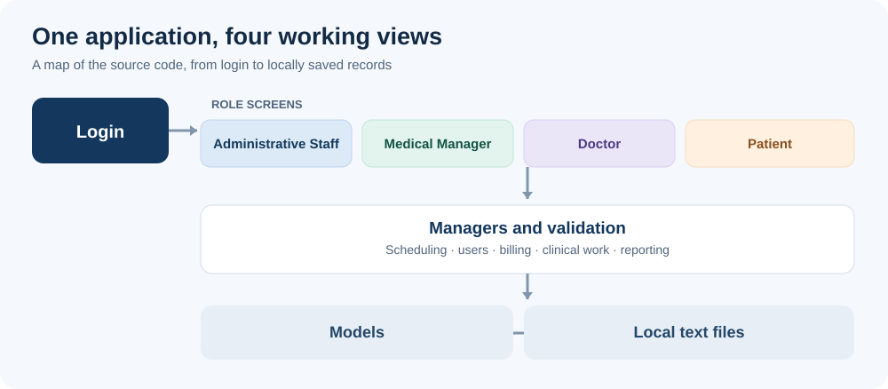
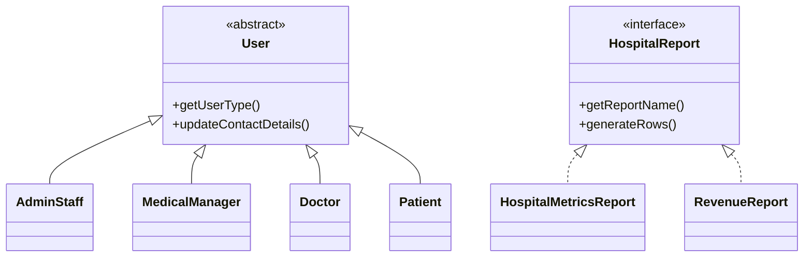

# Hospital Management System

A team-built Java Swing application that brings hospital administration and patient care tasks into one desktop workflow. It was designed around four types of user: Administrative Staff, Medical Managers, Doctors, and Patients. My principal contribution was the Administrative Staff area; the integrated application includes work by the rest of the team.

*Administrative Staff dashboard from a local working copy with fictional test data. The public repository does not include those records.*

## The problem and the approach

Appointments, doctor availability, medical records, requests, billing, and feedback are connected activities. The project goal was to let each role handle its part while sharing the same underlying records. A Patient can look for a consultation slot; a Medical Manager maintains the doctor shifts that make slots available; a Doctor records the visit; Administrative Staff manage users, resources, rates, and requests. The application uses role-specific screens over shared managers and models rather than putting every action into one interface.

This is a map of the source structure, not a claim that every path was rerun for this publication. The screenshot above shows the Administrative Staff interface; the other role screens can be explored in the linked source.

## What each role can do

| Role | Main work represented in the code |
| --- | --- |
| **Administrative Staff** | Manage users and doctors, assign resources to medical requests, review appointments, and maintain assets, consultation rates, and insurance networks. |
| **Medical Manager** | Maintain clinical departments and doctor shifts, and view operational and revenue reports. |
| **Doctor** | Review appointments, record assessments and vital signs, issue prescriptions, and request lab or imaging work. |
| **Patient** | Book or manage appointments and view clinical history, prescriptions, bills, and feedback. |

### Follow an appointment through the code

1. [DoctorShiftManager](src/HMS/manager/DoctorShiftManager.java) maintains the working shifts used to decide which times are available.
2. [AppointmentManager](src/HMS/manager/AppointmentManager.java) checks that the patient and doctor exist, the requested time is in a shift, and neither party has a conflicting booking before saving it.
3. The [Patient screens](src/HMS/ui/patient) expose booking and history, while the [Doctor screens](src/HMS/ui/doctor) expose appointments and clinical work. The [Administrative Staff screens](src/HMS/ui/admin) show the related management tasks.

This example shows why the four interfaces share application logic. It is a guide to the implementation, not a new end-to-end test result.

## Object-oriented design

The code models roles with an abstract [User](src/HMS/model/User.java) class and four concrete subclasses: [AdminStaff](src/HMS/model/AdminStaff.java), [MedicalManager](src/HMS/model/MedicalManager.java), [Doctor](src/HMS/model/Doctor.java), and [Patient](src/HMS/model/Patient.java). Shared identity and contact fields live in `User`; each subclass supplies its own `getUserType()` result. Reports use a separate [HospitalReport](src/HMS/model/HospitalReport.java) interface, implemented by report types such as [HospitalMetricsReport](src/HMS/model/HospitalMetricsReport.java) and [RevenueReport](src/HMS/model/RevenueReport.java).

The [managers](src/HMS/manager) hold the scheduling, user, billing, clinical, and reporting rules. [TextFileUtil](src/HMS/data/TextFileUtil.java) supports the file-backed persistence used by the project. The [tests](test/HMS) cover selected managers, navigation, and cross-role flows.

## Find your way around

| If you want to see… | Start with… |
| --- | --- |
| How the application starts | [Main.java](src/HMS/app/Main.java) |
| Role-specific windows and panels | [src/HMS/ui](src/HMS/ui) |
| Booking and validation rules | [AppointmentManager](src/HMS/manager/AppointmentManager.java) |
| The record and role types | [src/HMS/model](src/HMS/model) |
| How features were integrated over time | The [branches](https://github.com/46n/Hospital-Management-System-HMS-/branches) and [merged pull requests](https://github.com/46n/Hospital-Management-System-HMS-/pulls?q=is%3Apr+is%3Amerged) |

Read `main` for the integrated version. The older `feature-admin` branch records an earlier interface experiment.

## Run and limitations

Open the repository as a NetBeans project with a JDK that supports Java 26, then build and run `hms.app.Main`. The project configuration declares no external libraries. The public `main` tree has no seeded `data/` records or first-run account setup. To explore the role screens, create fictional local users in the format handled by [UserManager](src/HMS/manager/UserManager.java). A fresh build and full user-flow check for this publication are still pending.

This is a portfolio example, not a production medical system. Its local text-file storage and password handling are unsuitable for real patient information. Do not use real patient data or real passwords with it.
