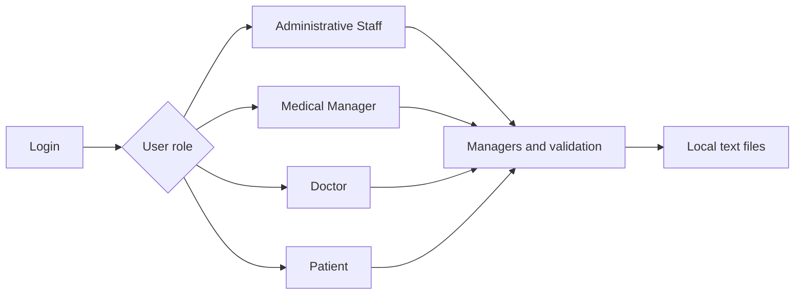

# Hospital Management System

A team-built Java Swing desktop application for hospital administration, appointments, and clinical workflows. My primary contribution was the Administrative Staff area. The integrated application includes work by the rest of the team.

*Administrative Staff dashboard from a local working copy. It contains no real patient data.*

## Explore the application

| Role | Main workflow |
| --- | --- |
| Administrative Staff | Manage users and doctors, appointments, assets, rates, and insurance networks. |
| Medical Manager | Coordinate departments, shifts, assessment types, and reports. |
| Doctor | Review appointments, record assessments and vital signs, issue prescriptions, and request tests. |
| Patient | Book appointments and review history, prescriptions, bills, and feedback. |

## Start reading the code

- [Application entry point](src/HMS/app/Main.java) creates the managers and starts the interface.
- [Role screens](src/HMS/ui) contain the Swing forms and panels.
- [Managers](src/HMS/manager) contain scheduling, billing, user, clinical, and reporting logic.
- [Models](src/HMS/model) define users, appointments, records, and hospital entities.
- [Tests](test/HMS) cover selected managers, navigation, and cross-role flows.

## Running locally

Open the repository as a NetBeans project with a JDK that supports Java 26, then build and run `hms.app.Main`. The project configuration declares no external libraries. This cleaned version excludes the original `data/` records, so test users and records need to be created locally before exploring every role. A fresh build and full user-flow check for this publication are still pending.

## Scope

This is a portfolio example, not a production medical system. Its local text-file storage and password handling are unsuitable for real patient information. Do not use real patient data or real passwords with it.
