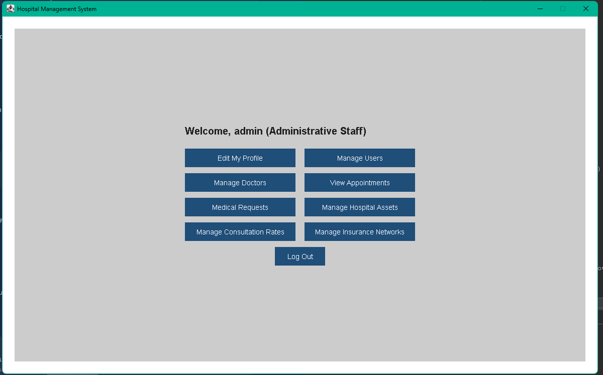

# Hospital Management System

**A Java Swing desktop application that brings four hospital roles into one workflow.** The project was built by a team; my main contribution was the Administrative Staff area. The integrated application includes work by the rest of the team.

*The Administrative Staff dashboard in a local working copy. It shows fictional test data only.*

## How the pieces connect

The diagram is a guide to the code structure. After login, each role opens a different set of screens. Managers handle the shared operations; models represent users, appointments, and clinical records; local text files hold the saved data.

| Role | A task you can trace in the source |
| --- | --- |
| **Administrative Staff** | Manage doctors and users, review appointments, and maintain assets, rates, and insurance networks. |
| **Medical Manager** | Set up departments and doctor shifts, then review reports. |
| **Doctor** | Review appointments, record assessments and vital signs, and issue prescriptions or test requests. |
| **Patient** | Book appointments and review history, prescriptions, bills, and feedback. |

## Take a short code tour

1. Start at [Main.java](src/HMS/app/Main.java) to see the managers and interface being created.
2. Follow the [Administrative Staff screens](src/HMS/ui/admin) into the [application managers](src/HMS/manager). The [appointment manager](src/HMS/manager/AppointmentManager.java) is one example of logic shared across roles.
3. Read the [models](src/HMS/model) to see the objects passed between screens and managers. The [tests](test/HMS) cover selected managers, navigation, and cross-role flows.

## Development and local run

The [branches](https://github.com/46n/Hospital-Management-System-HMS-/branches) and [merged pull requests](https://github.com/46n/Hospital-Management-System-HMS-/pulls?q=is%3Apr+is%3Amerged) show the team's development trail. Read `main` for the integrated version; `feature-admin` is an earlier interface experiment.

Open the repository as a NetBeans project with a JDK that supports Java 26, then build and run `hms.app.Main`. The project configuration declares no external libraries. The public `main` tree has no seeded `data/` records or first-run account setup. Exploring the role screens requires fictional local test users in the format handled by [UserManager](src/HMS/manager/UserManager.java). A fresh build and full user-flow check for this publication are still pending.

**Scope:** This is a portfolio example, not a production medical system. Its text-file storage and password handling are unsuitable for real patient information. Do not use real patient data or real passwords with it.
