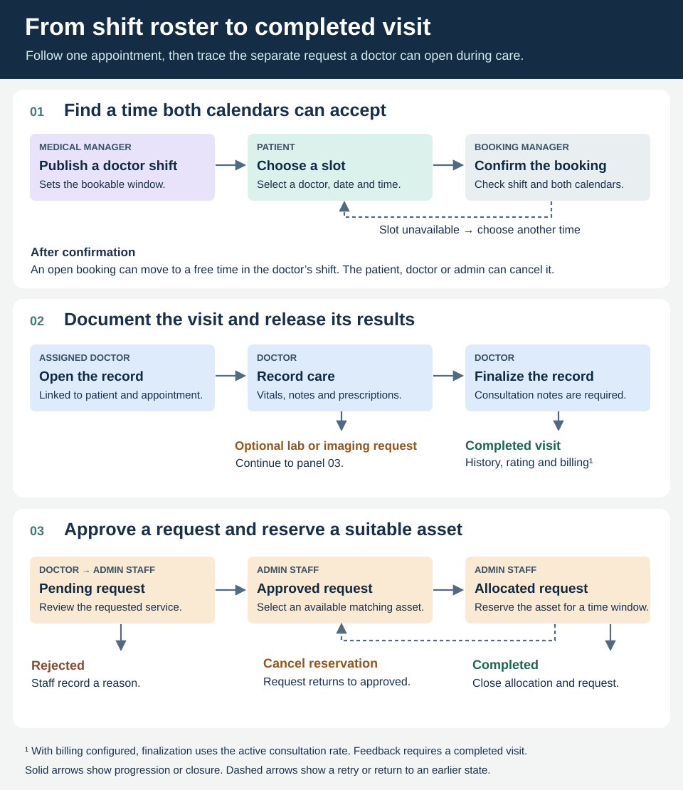
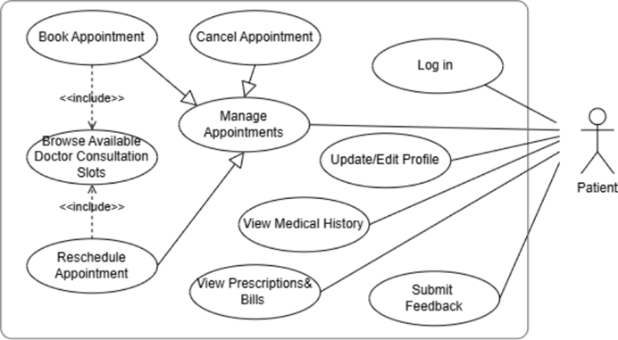

# Hospital Management System

A patient books a consultation, a doctor records the visit, and staff arrange any equipment the doctor requests. This Java Swing desktop application connects those steps through a shared appointment and medical record. Our team built the four role interfaces together. My principal contribution was the Administrative Staff area, including the workflow for managing requests and allocating hospital assets.

*The Administrative Staff dashboard in a local working copy. “Medical Requests” is where a clinical decision becomes an operational task. A doctor can ask for imaging, but staff still have to approve the request and find a suitable resource.*

[Follow a visit](#follow-a-visit) · [Explore the original diagrams](#original-design-diagrams) · [Read the source](#where-to-start-in-the-code) · [Run locally](#running-locally)

## Follow a visit

The map follows the patient from booking through a completed consultation. During care, the doctor can open a lab or imaging request that Administrative Staff manage separately. Each box names the role or manager responsible for the next decision.

*Open the map at full size to trace the return paths. An unavailable slot sends the patient back to time selection. Cancelling an asset reservation returns the already approved request to staff for another allocation.*

### How a booking reaches the right doctor

The Medical Manager maintains shifts. When a patient books, the scheduling code checks the date, both identities, the doctor's shift and both calendars. A free doctor can still be an invalid choice if the patient already has an appointment at that time. Once the checks pass, the manager creates a confirmed appointment, links it to both people, and saves it. The assigned doctor opens the record for that appointment. [Booking rules](src/HMS/manager/AppointmentManager.java) · [Clinical record handling](src/HMS/manager/ClinicalManager.java)

### What happens when a doctor requests imaging

Staff can approve the request before they know which asset will be available. Allocation is a second decision. The manager checks the request status, asset type, operational availability, and proposed time window. This distinction matters when plans change. Cancelling a scheduled allocation requires a reason and returns the request to **approved**, so staff can book a replacement. Completing the allocation marks the linked request **completed**. [Asset allocation rules](src/HMS/manager/AssetAllocationManager.java) · [Allocation tests](test/HMS/manager/AssetAllocationManagerTest.java)

### What closes a consultation

The doctor must enter consultation notes to finalize the record. Finalization marks the appointment completed. With billing configured, the application then looks up the active consultation rate to create the bill. A missing rate can therefore raise an error after the visit status has been saved. The patient can leave one rating from 1 to 5 for their own completed appointment. [Completion rule](src/HMS/model/MedicalRecord.java) · [Billing and feedback logic](src/HMS/manager/ClinicalManager.java)

## Original design diagrams

The team drew a use-case diagram for each role and a class diagram for the shared model. In the use-case drawings, start with the person at the edge and follow a line to an action. The patient view below gives the shortest route into the design.

| Role | What to trace in the original drawing |
| --- | --- |
| [Administrative Staff](figures/design-admin.png) | Follow a medical request into asset allocation, cancellation or completion. The account, doctor and rate branches show the setup work staff also own. |
| [Medical Manager](figures/design-manager.png) | Follow doctor shift management to see who makes slots available. The report branch shows how managers review workload, revenue and assessment usage. |
| [Doctor](figures/design-doctor.png) | Start at appointment selection and follow it into consultation notes, prescriptions, assessments or requests for additional services. |
| [Patient](figures/design-patient.png) | Follow booking into available slots, then look at the information a patient can access after the visit. |

**Reading the class diagram.** Start at `User` and follow the four role subclasses. Then find `Appointment` and `MedicalRecord` to see how a visit connects the patient and doctor to its clinical details. Open the full image to zoom into the fields and relationships. The drawing captures the team's design. The linked Java files describe the integrated implementation. [Full original class diagram](figures/design-classes.png) · [Java model](src/HMS/model)

## Where to start in the code

| Reader's question | Entry point |
| --- | --- |
| What starts the desktop app and connects its managers? | [Main.java](src/HMS/app/Main.java) |
| Where does each role see its work? | [Swing screens by role](src/HMS/ui) |
| What do the four roles share? | [User](src/HMS/model/User.java) defines their common fields and role method. [Doctor](src/HMS/model/Doctor.java) shows one specialization. |
| How do managers produce different reports through one interface? | [HospitalReport](src/HMS/model/HospitalReport.java) defines the contract. [RevenueReport](src/HMS/model/RevenueReport.java) implements it. |
| How are operations saved and tested? | [Text-file helper](src/HMS/data/TextFileUtil.java) and [cross-role integration test](test/HMS/integration/CrossRoleIntegrationTest.java) |
| How did the team integrate its work? | [Development branches](https://github.com/46n/Hospital-Management-System-HMS-/branches) and [merged pull requests](https://github.com/46n/Hospital-Management-System-HMS-/pulls?q=is%3Apr+is%3Amerged). Start with the integrated version on `main`. |

## Running locally

Open the repository in NetBeans with a JDK that supports Java 26, build the project, and launch `hms.app.Main`. The project configuration declares no external libraries. The public checkout starts without seeded accounts. Exploring a dashboard requires a fictional local user in the record format read by [UserManager](src/HMS/manager/UserManager.java).

The procedure map follows the published source. The dashboard image comes from a local working copy, and a fresh end-to-end run of the public checkout remains unverified. Use fictional records and credentials. The prototype stores data in local text files and is unsuitable for real patient information.
